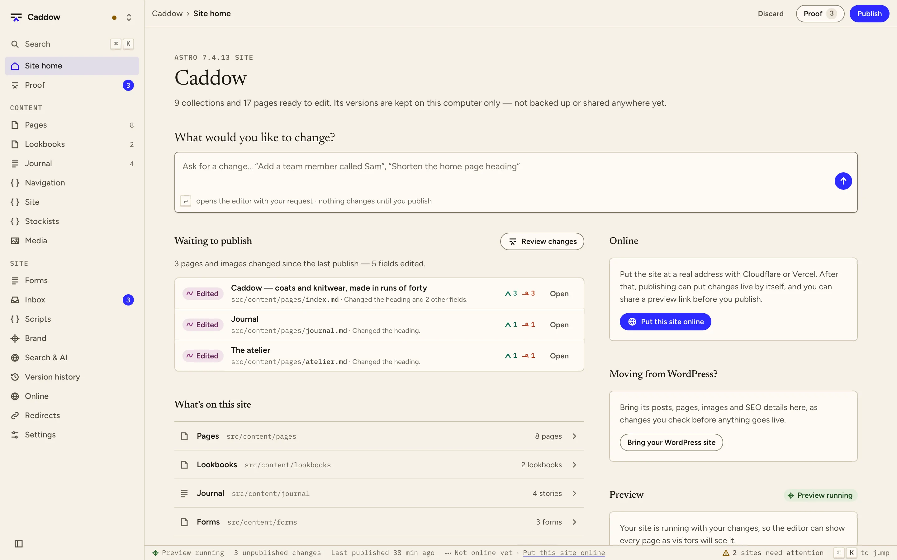

<div align="center">

<a href="https://galley.fictiontribe.com">
  <picture>
    <source media="(prefers-color-scheme: dark)" srcset="https://raw.githubusercontent.com/fictiontribe/galley/main/brand/logo/lockup-reverse.svg">
    
  </picture>
</a>

<p><strong>create-galley</strong> · a new site with Galley, the open-source AI CMS for static sites</p>

<p>
<a href="https://www.npmjs.com/package/create-galley"></a>
<a href="https://github.com/fictiontribe/galley/actions/workflows/ci.yml"></a>
<a href="https://github.com/fictiontribe/galley/blob/main/LICENSE"></a>
</p>

<p>
<a href="https://galley.fictiontribe.com">Website</a> ·
<a href="https://galley.fictiontribe.com/starters/">Starters</a> ·
<a href="https://galley.fictiontribe.com/tour/">Tour</a> ·
<a href="https://galley.fictiontribe.com/docs/">Docs</a> ·
<a href="https://github.com/fictiontribe/galley">GitHub</a>
</p>

</div>

```sh
npm create galley@latest
```

It asks which starter and what to call the site, copies the starter into a
new folder, records the first version, installs the dependencies and opens
Galley on it in your browser. It needs Node.js 22.23.4 or newer and git.

Without questions:

```sh
npm create galley@latest my-site -- --starter caddow
```

`pnpm create galley`, `yarn create galley` and `bun create galley` work the
same way, and the site's dependencies are installed with the package manager
you ran it with.

| Starter | What it is |
| --- | --- |
| `lowfield` (the default) | A site for a small studio or local business |
| `caddow` | A photography-led site for a small fashion label |
| `ferrow` | A marketing site for a software company |
| `sarking` | A blog for long-form writing with charts, tables and evidence |
| `storefront` | A shop for a small fashion label, with products from Shopify (in progress) |

<p align="center">
  
</p>

Options: `--starter <name>`, `--look <id>`, `--dir <folder>`,
`--use npm|pnpm|yarn|bun`, `--no-install`, `--no-open`, `--no-start`,
`--port <port>`. `npm create galley@latest -- --help` lists them all.

To open the site again later, run `npx galley-cms` in its folder.

create-galley is a small front door: the work is done by
[`galley-cms`](https://www.npmjs.com/package/galley-cms)'s `galley new`,
which is installed with it. Apache-2.0. Made by
[Fiction Tribe](https://www.fictiontribe.com).
