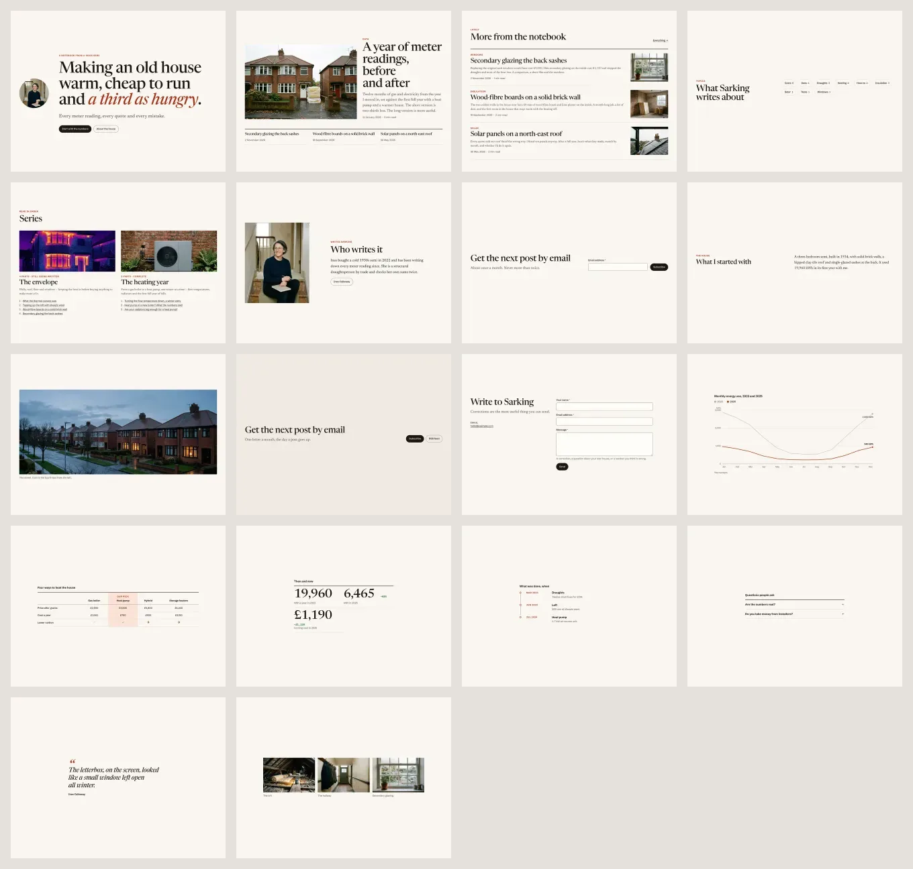
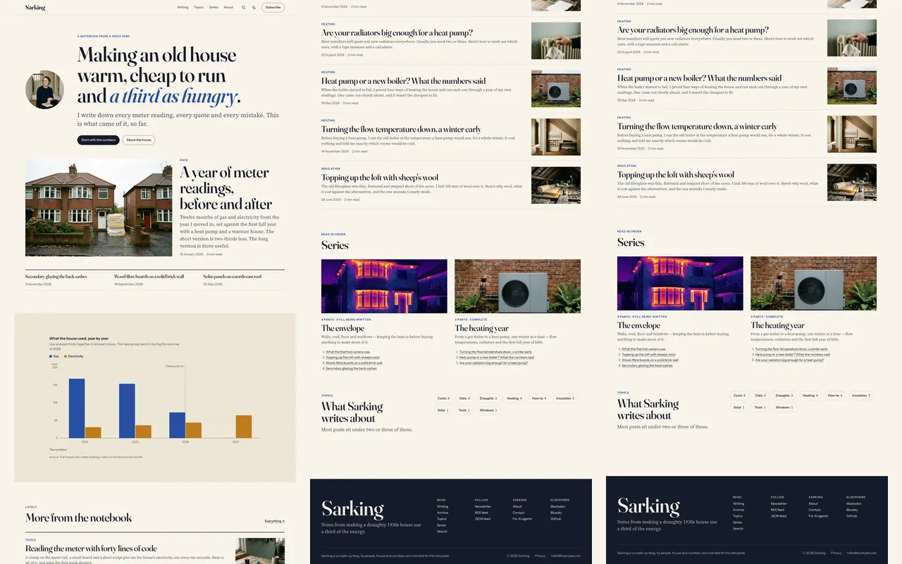
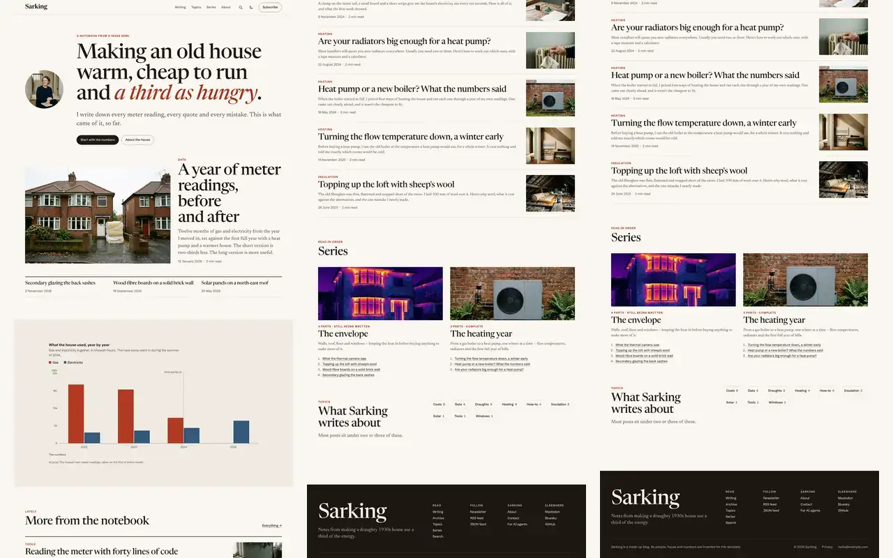
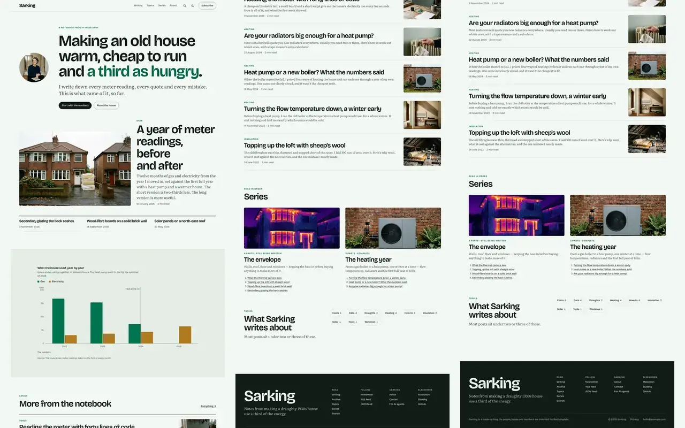

# Galley + Astro blog starter

A blog for people who write with evidence, built with
[Astro](https://astro.build). Long posts in plain Markdown, with charts,
comparison tables, verdicts, timelines and callouts written as fenced blocks
of YAML, drawn on the server and readable without JavaScript. Authors,
series, topics, an archive, search and full-text feeds. A Markdown copy of
every page, `llms.txt` and structured data for AI agents and search. Three
looks, each light and dark. No client-side framework, no CSS framework, no
tracking and no third-party requests.

The sample content is a made-up blog, **Sarking**: one person's notebook on
making a draughty 1930s house use a third of the energy. Every person, number
and house in it is invented. Replace it with your own.

Every word lives in plain Markdown and JSON, so you can edit it in any text
editor, or with [Galley](https://github.com/fictiontribe/galley), the
open-source AI CMS for static sites this starter is written for. Nothing here
depends on Galley: it is an ordinary Astro project.

[](https://deploy.workers.cloudflare.com/?url=https://github.com/fictiontribe/galley/tree/main/starters/astro-blog)
[](https://vercel.com/new/clone?repository-url=https%3A%2F%2Fgithub.com%2Ffictiontribe%2Fgalley%2Ftree%2Fmain%2Fstarters%2Fastro-blog&project-name=galley-astro-blog&repository-name=galley-astro-blog)



## What you get

- **Posts that hold evidence.** Twelve embeds, each a fenced block in plain
  Markdown with its own schema, so a typo fails the build with the post and
  the field named (and shows in place in `npm run dev`):

  | Block | Use it for |
  | --- | --- |
  | `chart` | Lines, areas, columns, bars or stacked columns from a few numbers, with a highlighted series, notes pinned to a label, and the numbers in a table beneath |
  | `compare` | Options side by side; yes / no / partly as marks, one column picked out, sticky row names on a phone |
  | `stats` | Two to four figures set large, each with how it moved |
  | `verdict` | The end of a review: score, one sentence, pros, cons, who it suits |
  | `proscons` | For and against |
  | `timeline` | Dated events on a line |
  | `steps` | How to do something, with a time or cost per step |
  | `faq` | Questions that open one at a time |
  | `gallery` | Photographs in a grid with captions |
  | `pullquote` | A line set large |
  | `video` | A poster that links to a film hosted elsewhere — nothing embedded |
  | `takeaways` | Points to take away |

  Plus GitHub-style callouts (`> [!NOTE]`, `[!TIP]`, `[!WARNING]`…),
  captioned figures, code with file names and a copy button (coloured by the
  look), footnotes and tables.

  ````md
  ```chart
  chart: line
  title: Monthly energy use, 2023 and 2025
  labels: [Jan, Feb, Mar, Apr, May, Jun]
  series:
    - name: "2023"
      values: [2900, 2600, 2200, 1500, 900, 600]
    - name: "2025"
      values: [980, 860, 700, 450, 300, 240]
  highlight: "2025"
  unit: kWh
  ```
  ````

- **A post page made for reading** — headline, standfirst and byline; the
  cover; "In short" from the post's `takeaways`; a contents list held beside
  long posts; then the record: topics, sources, how AI was used in writing it
  (`ai: none | research | editing | drafting`), what changed since
  publication, the author, the series, and what to read next.
- **Everything a blog needs around the posts** — a paginated list, a page
  per topic, series, author pages, an archive by year, search (a small index
  fetched only when someone searches), RSS and JSON feeds with every post in
  full, newer/older links, related posts, drafts, and posts dated in the
  future that appear in the first build after their date.
- **Ready for AI agents and search** — through Galley's site kit (vendored in
  `src/galley/`): a Markdown copy of every page (`/blog/post/` →
  `/blog/post.md`), `/llms.txt`, `/llms-full.txt`, `/agent.md`, JSON-LD
  (`BlogPosting` with author and dates, breadcrumbs, the site), `robots.txt`
  with a switch per AI crawler, and `sitemap.xml`. Charts carry their numbers
  as tables, so the Markdown copy has the data, not just a picture. Each post
  has "Copy as Markdown" and a link to its Markdown version.
- **Eighteen section types** for pages — intro, lead post, posts, topics,
  series, author, newsletter, text, photograph, invitation, contact, and the
  chart, comparison, figures, timeline, questions, pull quote and gallery
  embeds — with four templates (post, review, about, topic landing).
- **Three looks, each light and dark** — Almanac (cream and ink blue by day,
  navy and lamplight by night; the default), Ledger (warm paper, a newspaper
  serif, brick red) and Fieldbook (sage paper, a characterful grotesque, moss
  green). The page follows the reader's system setting; the switch in the
  header pins the other, remembered and applied before the first paint.
- **The basics done** — self-hosted fonts with the reading faces preloaded,
  images with their real sizes and a smaller file for phones, no layout
  shift, view transitions between pages where the browser has them, a skip
  link, visible focus, a mobile menu that works without JavaScript, reduced
  motion respected, and every page working under a sub-path such as a GitHub
  Pages project site.

| Almanac | Ledger | Fieldbook |
| --- | --- | --- |
|  |  |  |

## Start a project

Requires Node 22.23.4 or newer (Astro 7's minimum).

**With Galley** — a new site from this starter, dependencies installed, its first version in git, open in the editor:

```sh
npm create galley@latest my-site -- --starter sarking --look fieldbook
```

`--look` is optional: `almanac` (the default), `ledger` or `fieldbook`.

**As a plain Astro project:**

```sh
npm create astro@latest -- --template fictiontribe/galley/starters/astro-blog
```

With pnpm: `pnpm create astro@latest --template fictiontribe/galley/starters/astro-blog`.
With Yarn: `yarn create astro --template fictiontribe/galley/starters/astro-blog`.

```sh
npm install
npm run dev       # http://localhost:4321
npm run build     # writes the static site to dist/
npm run preview   # serves dist/ locally
```

## Where the content lives

```
src/
├── content/
│   ├── blog/         one Markdown file per post → /blog/<file>/
│   ├── authors/      one per author → /authors/<file>/
│   ├── series/       one per series → /series/<file>/
│   ├── pages/        pages built from sections; index.md is the home page
│   └── forms/        newsletter.json, contact.json
├── data/
│   ├── site.json        name, tagline, social links, feeds, every interface label
│   ├── navigation.json  header, footer and legal links
│   ├── visibility.json  AI crawlers, llms.txt, structured data
│   └── scripts.json     analytics, off until you switch it on
├── styles/tokens.css    the look: colours (light and dark), fonts, sizes, spacing
└── content.config.ts    the schema for all of the above, embeds included
public/images/           photographs, written in content as /images/…
```

A post:

```md
---
title: Heat pump or a new boiler? What the numbers said
description: When the boiler started to fail, I priced four ways of heating the house.
date: 2024-05-18
author: ines-calloway
tags: [Heating, Costs]
image: /images/blog/heat-pump.webp
imageAlt: A grey heat pump against a brick garden wall.
takeaways:
  - Over fifteen years, the heat pump came out about £6,000 cheaper.
sources:
  - title: Three installer quotes for each system
ai: none
---

In February 2024 the boiler started locking out on cold mornings…
```

[`CONTENT-GUIDE.md`](./CONTENT-GUIDE.md) lists every field, embed and
section, with the house rules for charts.

Write links and images from the site root (`/blog/…`, `/images/…`); they are
adjusted for you when the site is served under a sub-path, in front matter
and in post bodies alike.

## Edit with Galley

[Galley](https://github.com/fictiontribe/galley) is an open-source
(Apache-2.0) AI CMS for static sites, built for Astro. It reads this project
as it is — collections, section types and their variants come from
`src/content.config.ts` — and everything you change is a plain edit to these
files, published as a git commit. Nothing is installed into the site.

One command in the project folder starts it and opens your browser
(`npm run galley` does the same):

```sh
npx galley-cms
```

On this starter, Galley gives you a form for every post, author, series,
page and setting; a section palette with a picture of each of the eighteen
types; click-to-edit on the preview; an assistant that follows
[`CONTENT-GUIDE.md`](./CONTENT-GUIDE.md) and writes embeds as well as words;
and proof-then-publish, where every change waits beside the published page
until you press Publish. Posts are Markdown rather than MDX on purpose: on a
hosted Galley, contributors can edit Markdown without being trusted with code.

`galley.config.json` holds what Galley can't read from the code: URL
patterns, the media folder, the content guide, a label, description and
picture for each section type, and four **templates** — ready-made posts and
pages to start from, kept as ordinary content files in `galley/templates/`.
Other tools ignore all of it. `starter.json` describes the starter and its
looks to Galley's new-site wizard and is not copied into new sites.

Galley's pictures — `galley/sections/*.webp`, `galley/templates/*.webp` and
`galley/previews/*.webp` — are photographs of a real build, made by
`scripts/make-thumbnails.mjs`. It builds the site with a hidden section
gallery (`/__gallery/`, only when `SECTION_GALLERY` is set — never in a
normal build, the sitemap or the menus), once per look, and screenshots it in
headless Chromium. It installs nothing: point it at any `node_modules` that
has `playwright-core`:

```sh
PLAYWRIGHT_MODULES=/path/to/node_modules/ node scripts/make-thumbnails.mjs
```

(`PLAYWRIGHT_CHROMIUM=/path/to/chrome` uses another browser binary.)

## Make it yours

- **Remove the demo notice** — delete `starterNotice` from
  `src/data/site.json`, if it is there.
- **Set your address** — change `url` in `src/data/site.json` before you
  deploy; it is used for canonical links, feeds, share images, `robots.txt`
  and `sitemap.xml`.
- **Write your own authors** — replace the files in `src/content/authors/`
  and point each post's `author` at one.
- **Rewrite the content guide** — its Voice section describes Sarking.
  Galley's assistant reads it before every change.
- **Choose your AI crawlers** — `src/data/visibility.json` → `crawlers`, for
  example `{ "GPTBot": "block", "CCBot": "block" }` to keep training crawlers
  out while letting AI search in.

### Change the look

Everything visual is a custom property in
[`src/styles/tokens.css`](./src/styles/tokens.css); no colour or font name
appears anywhere else. Every colour is a `light-dark()` pair. To switch to
another look:

```sh
cp src/styles/themes/ledger.css src/styles/tokens.css    # or fieldbook.css, almanac.css
```

Fonts are self-hosted from `@fontsource-variable` packages under the SIL
Open Font Licence: Fraunces, Source Serif 4, Instrument Sans and Martian
Mono (Almanac); Newsreader, Schibsted Grotesk and Geist Mono (Ledger);
Literata, Bricolage Grotesque and JetBrains Mono (Fieldbook). The `preload:`
line at the top of each look names the files to preload. Keep text colours
at least 4.5:1 against their ground in both schemes.

### Add an embed or a section type

1. **Component** — `src/components/embeds/<Name>.astro` or
   `src/components/sections/<Name>.astro`, styled with tokens only, with any
   interface words in `site.json` → `labels`.
2. **Schema** — in `src/content.config.ts`: for an embed, a `<name>Fields`
   object, an entry in `embedSchemas`, and the kind in
   `src/lib/embed-kinds.ts`; for a section, a `z.object({ type:
   z.literal("<name>"), …common })` in the `section` union.
3. **Renderer** — add it to `src/components/embeds/Embed.astro` or
   `src/components/Sections.astro`, and give `src/lib/feed.ts` a plain HTML
   version for feed readers.
4. **Document and picture it** — `CONTENT-GUIDE.md`, an example in
   `scripts/gallery/sections.md`, an entry in `galley.config.json`, then
   `make-thumbnails.mjs`.

### Forms, scripts and email links

The site kit (`src/galley/`, Apache-2.0, vendored from Galley) renders the
newsletter and contact forms from `src/content/forms/` (sent to the Galley
inbox once `forms.endpoint` is set in `src/galley/settings.json`; until then
a form says it isn't connected), manages analytics from
`src/data/scripts.json` behind a consent banner (one example, switched off),
and offers Gmail, Outlook, the mail app or copy on every email link. Its
styles are mapped onto the tokens in `src/styles/galley-kit.css`.

## Deploy

`npm run build` writes a plain static site to `dist/` that any static host
can serve; `dist/404.html` is the not-found page. `--site` and `--base` let a
host supply the address, for example
`npm run build -- --site https://you.github.io --base /my-blog`.

[](https://deploy.workers.cloudflare.com/?url=https://github.com/fictiontribe/galley/tree/main/starters/astro-blog)
[](https://vercel.com/new/clone?repository-url=https%3A%2F%2Fgithub.com%2Ffictiontribe%2Fgalley%2Ftree%2Fmain%2Fstarters%2Fastro-blog&project-name=galley-astro-blog&repository-name=galley-astro-blog)

The buttons copy this starter into a new repository in your own GitHub
account and build it there on every push.

- **Netlify** — `netlify.toml` is included. Import the repository.
- **Vercel** — import the repository; the Astro preset fills in the settings.
- **Cloudflare** — `wrangler.jsonc` is included: the button above, or
  `npx wrangler deploy` after `npm run build`.
- **GitHub Pages** — build with `--site` and `--base` from
  `actions/configure-pages` and upload `dist/`.
- **Anything else** — upload `dist/`, with `index.html` as the index document
  and `404.html` as the error page.

## Notes

- Drafts (`draft: true`) and posts dated in the future show in `npm run dev`
  only; a scheduled post appears in the first build after its date.
- There is no lockfile here, so npm, pnpm, Yarn and Bun each write their own.
- `sharp` (a dev dependency) is only for the photograph and thumbnail
  scripts; the site itself does not need it.

## Licence

MIT — see [LICENSE](./LICENSE). Made by Fiction Tribe, the makers of Galley.
The photographs were made for this template and are licensed with it. Astro
is a trademark of its respective owner; this template is an independent
project and is not affiliated with or endorsed by the Astro project. The
fonts are distributed under the SIL Open Font Licence.
