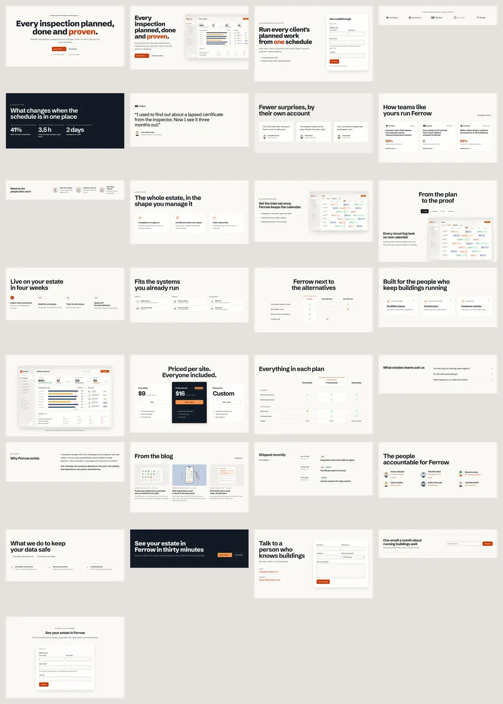

# Galley B2B / SaaS starter

A marketing site for a software company, built with
[Astro](https://astro.build) and assembled entirely from a library of 29
section types — heroes, proof, product, pricing, content and conversion —
that you can stack, reorder and restyle. Customer stories, a changelog, a
blog with tags, a team, three working forms, seven page templates and three
complete looks. No client-side framework, no CSS framework, and no tracking
or third-party requests until you add them — behind a consent banner. The sample content is a made-up maintenance-software company,
Ferrow — replace it with your own.

Every word on the site lives in Markdown and JSON files, so you can edit it
in any text editor, or visually with [Galley](https://github.com/fictiontribe/galley),
the open-source AI CMS for static sites that this starter is built for.
Nothing here depends on Galley: it is an ordinary Astro project.

[](https://deploy.workers.cloudflare.com/?url=https://github.com/fictiontribe/galley/tree/main/starters/astro-saas)
[](https://vercel.com/new/clone?repository-url=https%3A%2F%2Fgithub.com%2Ffictiontribe%2Fgalley%2Ftree%2Fmain%2Fstarters%2Fastro-saas&project-name=galley-astro-saas&repository-name=galley-astro-saas)



## What you get

- **Fourteen pages** — home, product, two solution pages, pricing,
  customers, about, security, contact, blog, changelog, privacy, terms and
  a not-found page — each a Markdown file whose front matter lists its
  sections.
- **A section library** of 29 types in six families. Each has a typed
  schema (a typo fails the build with a clear message) and a few named
  variants — alignment, image side, columns, layout, card style, tone:

  | Family | Sections |
  | --- | --- |
  | Heroes | `hero` (statement) · `hero-split` (beside a screenshot) · `hero-form` (beside a lead form) |
  | Proof | `logos` · `metrics` · `testimonial` · `testimonials` · `case-studies` (from the customers collection) · `awards` |
  | Product | `features` · `feature-split` · `feature-tabs` · `steps` · `integrations` · `comparison` · `use-cases` · `screenshot` |
  | Pricing | `pricing` · `pricing-table` · `faq` |
  | Content | `rich-text` · `posts` · `changelog` · `team` |
  | Trust and conversion | `security` · `cta` · `contact` · `newsletter` · `form` (any form, on any page) |

  [`CONTENT-GUIDE.md`](./CONTENT-GUIDE.md) lists every field and variant,
  when to use each section and which ones go together.
- **Collections** — customer stories with results and quotes, each with
  its own page; a changelog with New / Improved / Fixed labels; blog posts
  with authors, reading time and a page per tag; the leadership team.
- **Three real forms** — a contact form, a two-step demo request (work
  email only, campaign attribution, a conversion event) and a newsletter
  sign-up, each one JSON file. They send to the Galley inbox, check answers
  as visitors type, work without JavaScript and take the site's look.
  See [Forms, scripts and email links](#forms-scripts-and-email-links).
- **Navigation with drop-down menus** grouped by Product, Solutions,
  Resources and Company, two header buttons, footer columns and legal links
  — all in `src/data/navigation.json`. The menus are native disclosure
  elements, so they work by keyboard and without JavaScript.
- **Product imagery that follows the look** — the screenshots, logos and
  portraits are SVG files drawn in the site's colour tokens and inlined into
  the page, so they change with the theme, dark included.
- **Three looks** — *Signal* (warm paper, ink, signal orange; the default),
  *Meridian* (mint paper, deep green, rounder) and *Night shift* (dark). Each
  is one tokens file.
- **The basics done** — self-hosted variable fonts, `sitemap.xml`,
  `robots.txt`, Open Graph tags, a skip link, visible focus, WCAG AA
  contrast in every look and tone, reduced motion respected, and builds
  that work at a domain root or under a sub-path.

## Start in 60 seconds

Requires Node 22.23.4 or newer (Astro 7's minimum).

**With Galley** — a new site from this starter,
dependencies installed, its first version in git, open in the editor:

```sh
npm create galley@latest my-site -- --starter ferrow --look meridian
```

`--look` is optional: `signal` (the default), `meridian` or `night-shift`.

**As a plain Astro project:**

```sh
npm create astro@latest -- --template fictiontribe/galley/starters/astro-saas
```

With pnpm: `pnpm create astro@latest --template fictiontribe/galley/starters/astro-saas`.
On GitHub you can also press **Use this template**. Then:

```sh
npm install
npm run dev       # http://localhost:4321
npm run build     # writes the static site to dist/
npm run preview   # serves dist/ locally
```

## Where the content lives

```
src/
├── content/
│   ├── pages/         one Markdown file per page; index.md is the home page
│   ├── customers/     customer stories → /customers/<file>/
│   ├── blog/          blog posts → /blog/<file>/
│   ├── changelog/     product updates, all on /changelog/
│   ├── team/          the leadership team
│   └── forms/         one JSON file per form: contact, demo, newsletter
├── data/
│   ├── site.json        name, contact details, social links, share image,
│   │                    and every interface label
│   ├── navigation.json  header menus and buttons, footer, legal links
│   └── scripts.json     third-party tags and the consent banner (empty)
├── galley/              the site kit, vendored: forms, scripts, email links
│   └── settings.json    where forms send (`forms.endpoint`), email-link options
├── styles/
│   ├── tokens.css       the look: colours, fonts, sizes, spacing
│   ├── themes/          the three looks, each a complete tokens file
│   └── kit.css          the forms, banner and email dialog in those tokens
└── content.config.ts    the schema for all of the above
public/images/           images, referenced in content as /images/…
galley/                  section thumbnails, page templates, look previews
```

A page is a list of **sections** in front matter:

```yaml
---
title: Pricing
description: Simple pricing per site, with every user included.
sections:
  - type: hero
    heading: Priced per site. *Everyone* included.
  - type: pricing
    heading: Choose the plan that fits your estate
    items:
      - { name: Essentials, price: $9, period: per site / month }
      - { name: Professional, price: $16, featured: true, badge: Most chosen }
  - type: cta
    heading: Not sure which plan fits?
    cta: { label: Talk to sales, href: /contact/ }
---
```

Write links and images from the site root (in forms too) (`/contact/`,
`/images/product/planner.svg`); they are adjusted for you when the site is
served under a sub-path — in front matter, in `src/data/` and in Markdown
bodies alike.

## Build pages by dragging sections — edit with Galley

[Galley](https://github.com/fictiontribe/galley) is an open-source
(Apache-2.0) AI CMS for static sites, built for Astro. It reads this project
as it is — collections, the 29 section types and every field come from
`src/content.config.ts` — and every change is a plain edit to these files,
published as a git commit. Nothing is installed into the site.

One command in the project folder starts it and opens your browser
(`npm run galley` does the same):

```sh
npx galley-cms
```

On this starter, Galley's visual page builder gives you:

- **A section palette with pictures** — every section type with its name, a
  line on when to use it and a thumbnail of it rendered with real content
  (`galley/sections/`). Drag one onto the page, or drag sections to reorder
  them.
- **The page, mapped** — every rendered section carries
  `data-galley-block="sections.3"` and `data-galley-block-type="pricing"`, so
  the preview knows which part of the page is which entry in the list:
  select a section on the page to edit its fields, switch its variants, or
  click any text to change it in place.
- **Page templates** — start a new page from a landing, product, solution,
  pricing, about or contact page, or a new customer story, already composed
  (`galley/templates/`).
- **The assistant** — ask for a change in plain words ("add a comparison
  with spreadsheets to the contractors page"). It follows
  [`CONTENT-GUIDE.md`](./CONTENT-GUIDE.md).
- **Forms, Inbox and Scripts** — the form builder edits the files in
  `src/content/forms/` (fields, steps, conditions, destinations, the
  thank-you), the Inbox collects what visitors send, and the Scripts screen
  adds tags to `src/data/scripts.json` behind the consent banner.
- **Proof and publish** — every change waits beside the published page until
  you press Publish.

`galley.config.json` holds what Galley can't read from the code: the URL
patterns, the media folder, the content guide, each section's label,
description and thumbnail, and the templates. Other tools ignore it.

## Edit without Galley

Nothing here needs Galley. Every page is a Markdown file, every setting a
JSON file, every form a JSON file whose format is documented in Galley's
[forms guide](https://github.com/fictiontribe/galley/blob/main/docs/forms.md);
the build checks them all against `src/content.config.ts` and stops with a
plain message when something is wrong. Edit them in any editor, commit, and
your host rebuilds.

## Forms, scripts and email links

The site kit lives in `src/galley/` as plain files (no package to install)
and turns three kinds of content file into working features:

- **Forms** — `src/content/forms/<id>.json`. `contact` asks for name, work
  email, company, topic and message. `demo` has two steps, refuses free
  mailboxes, records the campaign tags on the page's address (`utm_source`,
  `utm_medium`, `utm_campaign`) in hidden fields, pushes a `generate_lead` event to the
  `dataLayer` and thanks the visitor by name. `newsletter` is one inline
  field. Sections pick a form by file name (`form: demo` on `hero-form`,
  `contact`, `newsletter`), and the `form` section puts any form on any page.
  Forms are rendered on the server, work without JavaScript, check answers
  as visitors type, and are styled only by `src/styles/kit.css` from this
  site's tokens — every look and tone applies.
- **Where submissions go** — each form's `destinations` is the Galley inbox
  (`"provider": "galley"`), which stores submissions, e-mails you and
  forwards them, with no other account. Put your site's capture address
  (Galley shows it in Inbox › Capture settings) in
  `src/galley/settings.json` → `forms.endpoint`. Until it is set, the build
  says so and a submitted form tells the visitor it isn't connected yet.
  HubSpot, Marketo, Salesforce, Account Engagement, any webhook or the
  visitor's mail app are other destinations — see the forms guide.
- **Third-party scripts** — `src/data/scripts.json` ships with no scripts,
  the built-in consent banner and Google Consent Mode on. Add Google Tag
  Manager, GA4 or another tag there (Galley's Scripts screen writes it for
  you) and it loads only after the visitor agrees; the banner and a
  "Privacy choices" link in the footer appear only then.
- **Email links** — every `mailto:` link offers Gmail, Outlook, the
  visitor's mail app or copying the address. `"mailto": false` in
  `src/galley/settings.json` turns it off.

To update the kit, run Galley's `node packages/astro/scripts/vendor.mjs
<this folder>`; it replaces `src/galley/` and keeps `settings.json`.

## Add a section type

1. **Component** — create `src/components/sections/Quote.astro`. Copy a
   similar section: type its props with an `interface Props` (including
   `block?: BlockMarker`), wrap the markup in
   `<Section type="quote" id={id} tone={tone} block={block}>`, use
   `SectionHeader` for eyebrow/heading/text, and pass every link or image
   path through `withBase()` from `src/lib/site.ts`. Words come from props
   or from `labels` in `site.json`; colours, fonts and sizes only from
   tokens (`var(--tone-text)`, `var(--space-l)`, …).
2. **Schema** — in `src/content.config.ts`, add
   `quoteSection = z.object({ type: z.literal("quote"), ...common, … })`
   and add it to the `section` discriminated union. Make variants enums
   (`z.enum(["left", "right"])`) so editors get a choice, not a text box.
3. **Renderer** — in `src/components/Sections.astro`, import the component
   and add `quote: Quote` to `components`.
4. **Describe it** — add `{ type, label, description, thumbnail:
   "galley/sections/quote.webp" }` to the `sections` blocks in
   `galley.config.json`, and a row to `CONTENT-GUIDE.md`.
5. **Picture it** — add one example to `scripts/gallery/sections.md`, then
   run `npm run thumbnails` (below).

A section whose `type` has no component shows a dashed notice in
development and renders nothing in a production build.

## Looks and re-theming

Everything visual is a custom property in
[`src/styles/tokens.css`](./src/styles/tokens.css); no colour or font name
appears anywhere else. `src/styles/themes/` holds three complete
alternatives with the same properties — `signal.css` (identical to the
default), `meridian.css` and `night-shift.css`. To switch look, copy one
over the tokens file:

```sh
cp src/styles/themes/night-shift.css src/styles/tokens.css
```

To make your own: change `--color-accent` and its partners
(`-strong`, `-contrast`, `-soft`, `-on-inverse`), the neutrals, and the
`--shot-*` colours the product imagery is drawn with; swap the font
`@import` lines (any `@fontsource-variable` package) and `--font-display` /
`--font-body`. Keep every text colour at least WCAG AA (4.5:1) on its
ground; the comment at the top of the tokens file says which pairs matter.

## Page templates

`galley/templates/` holds ready-made pages — `landing.md`, `product.md`,
`solution.md`, `pricing.md`, `about.md`, `contact.md` and
`customer-story.md` — as ordinary content files with starting-point copy.
Copy one into `src/content/pages/` (or `src/content/customers/` for the
story) to start a page by hand; Galley offers them when you create a page.

## Thumbnails and previews

The pictures in `galley/` are made from the site itself:

```sh
PLAYWRIGHT_MODULES=/path/to/node_modules npm run thumbnails
```

The script builds the site with a section gallery switched on
(`/__gallery/`, never part of a normal build), photographs every section,
every template and the home page in each look with headless Chromium, and
writes WebP files. `playwright-core` is not a dependency: point
`PLAYWRIGHT_MODULES` at any `node_modules` folder that has it and a
downloaded Chromium (`npm install playwright-core && npx playwright install chromium`).

`npm run check:type` (same `PLAYWRIGHT_MODULES`) checks that the build and
`astro dev` set identical type — Galley's Proof shows the live site (a build)
beside the proposed page (the dev server), so any difference would read as two
fonts. It builds and serves the site, starts `astro dev` beside it, and
compares every piece of text on every page at 1440 and 390 wide: font
properties, rendered width and the first screen's pixels. `--looks` runs all
three looks; `--linked` runs from a copy whose `node_modules` is a link (pnpm,
shared installs), the layout in which dev used to refuse the font files.

## Make it yours

- **Remove the demo notice** — delete `starterNotice` from
  `src/data/site.json` (only the template repository has it). The bar and
  its few lines of script go with it.
- **Set your address** — change `url` in `src/data/site.json` before you
  deploy; it is used for canonical links, share images, `robots.txt` and
  `sitemap.xml`.
- **Rewrite the content guide** — `CONTENT-GUIDE.md` describes Ferrow's
  voice. Rewrite its Voice section for your company.
- **Connect the forms** — set `forms.endpoint` in
  `src/galley/settings.json` (see above), or change each form's
  destination.

## Deploy

`npm run build` writes a plain static site to `dist/`; `dist/404.html` is
the not-found page. A host can supply the address without editing
`site.json`: `npm run build -- --site https://you.github.io --base /my-site`.

[](https://deploy.workers.cloudflare.com/?url=https://github.com/fictiontribe/galley/tree/main/starters/astro-saas)
[](https://vercel.com/new/clone?repository-url=https%3A%2F%2Fgithub.com%2Ffictiontribe%2Fgalley%2Ftree%2Fmain%2Fstarters%2Fastro-saas&project-name=galley-astro-saas&repository-name=galley-astro-saas)

The buttons copy this starter into a new repository in your own GitHub
account and build it there on every push.

- **Netlify** — `netlify.toml` is included. Import the repository.
- **Vercel** — import the repository; set `url` in `site.json`.
- **Cloudflare** — the button above, or `npm run build && npx wrangler deploy`
  (`wrangler.jsonc` publishes `dist/` as static assets).
- **GitHub Pages** — build in a workflow with `--site` and `--base` from
  `actions/configure-pages`, and publish `dist/`.
- **Anything else** — upload `dist/` with `index.html` as the index
  document and `404.html` as the error page.

## Notes

- Fonts are self-hosted from `@fontsource-variable` packages under the SIL
  Open Font Licence: Schibsted Grotesk, Geist, Geist Mono, Bricolage
  Grotesque and Public Sans.
- Pages with `noindex: true`, drafts and the 404 page are left out of
  `sitemap.xml`. Drafts (`draft: true`) show in `npm run dev` only.
- Ferrow, its customers, people, figures, ratings and awards are invented.
  The integrations named are open standards, not products.

## Licence

MIT — see [LICENSE](./LICENSE). Made by Fiction Tribe, the makers of Galley.
Astro is a trademark of its respective owner; this template is an
independent project and is not affiliated with or endorsed by the Astro
project.
