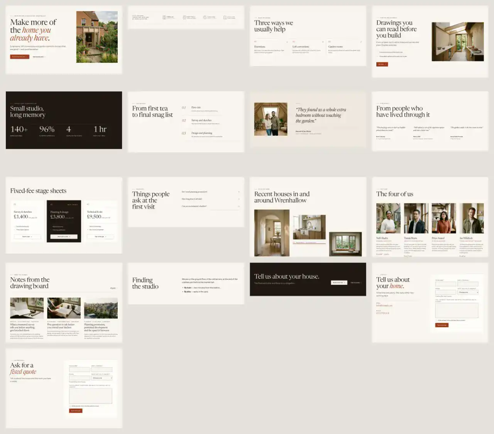
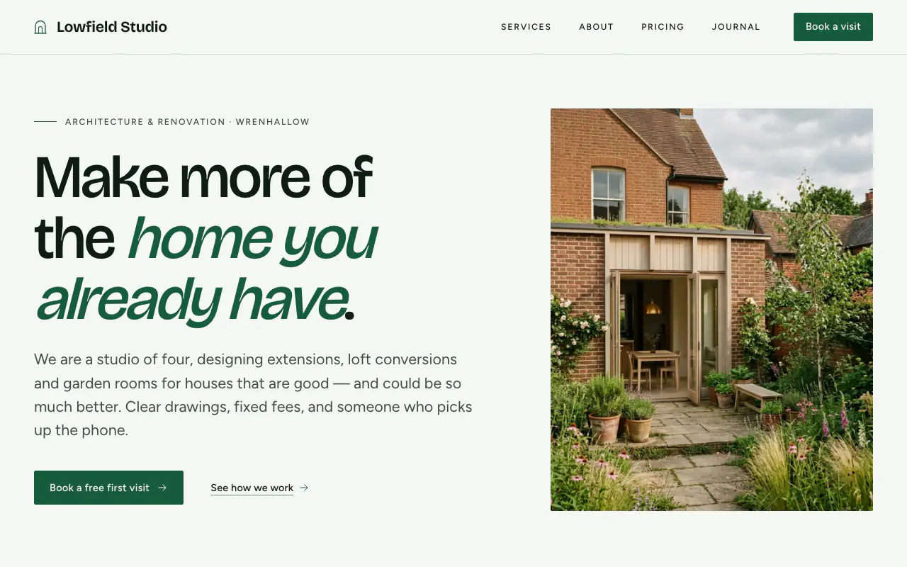
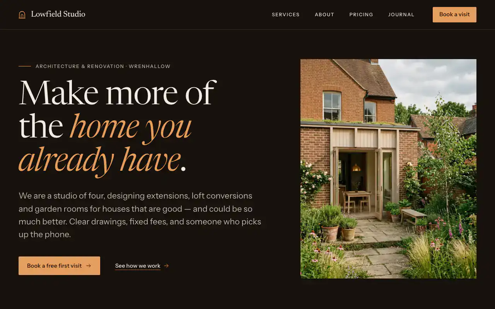

# Galley + Astro starter — small studio or business

A static marketing site for a small studio or local business, built with
[Astro](https://astro.build): pages assembled from seventeen section types,
a working contact form, a journal with authors and tags, a team, five page
templates and three complete looks. No client-side framework, no CSS
framework, and no tracking or third-party requests until you add them —
behind a consent banner. The sample content is a made-up architecture
practice, Lowfield Studio — replace it with your own.

Every word on the site lives in plain Markdown and JSON files, so you can
edit it in any text editor, or visually with
[Galley](https://github.com/fictiontribe/galley), the open-source AI CMS for
static sites that this starter is built for. Nothing here depends on Galley:
it is an ordinary Astro project.

[](https://deploy.workers.cloudflare.com/?url=https://github.com/fictiontribe/galley/tree/main/starters/astro-starter)
[](https://vercel.com/new/clone?repository-url=https%3A%2F%2Fgithub.com%2Ffictiontribe%2Fgalley%2Ftree%2Fmain%2Fstarters%2Fastro-starter&project-name=galley-astro-starter&repository-name=galley-astro-starter)



## Start in 60 seconds

Requires Node 22.23.4 or newer (Astro 7's minimum).

**With Galley** — a new site from this starter,
dependencies installed, its first version in git, open in the editor:

```sh
npm create galley@latest my-site -- --starter lowfield --look sage
```

`--look` is optional: `lowfield` (the default), `sage` or `evening`.

**As a plain Astro project:**

```sh
npm create astro@latest -- --template fictiontribe/galley/starters/astro-starter
```

With pnpm: `pnpm create astro@latest --template fictiontribe/galley/starters/astro-starter`.
With Yarn: `yarn create astro --template fictiontribe/galley/starters/astro-starter`.
On GitHub you can also press **Use this template**. Then:

```sh
npm install
npm run dev       # http://localhost:4321
npm run build     # writes the static site to dist/
npm run preview   # serves dist/ locally
```

## What's inside

- **Eight pages** — home, services, about, pricing, contact, journal,
  privacy and a not-found page — each a Markdown file whose front matter
  lists its sections.
- **A section library** of seventeen types, each with its own schema (a
  typo fails the build with a clear message) and a few named variants:

  | Section | Use it for |
  | --- | --- |
  | `hero` | The opening of a page, with an optional image |
  | `logos` | A quiet row of client or partner logos |
  | `features` | Services, benefits or principles, with icons |
  | `split` | One idea beside a picture, left or right |
  | `stats` | Two to four numbers that prove a claim |
  | `steps` | A process, in order |
  | `testimonial` | One quote, set large |
  | `testimonials` | Several shorter quotes |
  | `pricing` | Plans or packages, one of them highlighted |
  | `faq` | Questions and answers, as an accordion |
  | `gallery` | A grid of images with captions |
  | `team` | People from the team collection |
  | `posts` | The latest journal posts |
  | `rich-text` | A passage of Markdown |
  | `cta` | The closing invitation |
  | `contact` | Contact details beside the contact form |
  | `form` | Any form, on any page |

  [`CONTENT-GUIDE.md`](./CONTENT-GUIDE.md) lists every field, variant and
  which sections go together.
- **A contact form** — `src/content/forms/contact.json`: name, email,
  phone, what they're planning, a message and a "book a first visit" box,
  with a thank-you by name. It sends to the Galley inbox, checks answers as
  visitors type, works without JavaScript and takes the site's look. See
  [Forms, scripts and email links](#forms-scripts-and-email-links).
- **A journal** — posts with an author from `src/content/authors/` (name,
  role, photo, bio), reading time, newer and older links, paginated
  listings and a page for every tag.
- **A team** collection, shown by the `team` section.
- **Three looks** — *Lowfield* (warm paper and terracotta, Newsreader and
  Instrument Sans; the default), *Sage* (cool green, rounded, Bricolage
  Grotesque and Figtree) and *Evening* (dark). Each is one tokens file.
- **Five page templates** — a service page, a project story, about,
  contact and a journal post, ready to start a new page from.
- **Settings files** — `src/data/site.json` (name, contact details,
  social links, share image and every interface label) and
  `src/data/navigation.json` (header and footer links). Components contain
  no copy at all.
- **The basics done** — self-hosted variable fonts, `sitemap.xml`,
  `robots.txt`, Open Graph tags, a skip link, visible focus, a mobile menu
  that works without JavaScript, reduced motion respected, WCAG AA contrast
  in every look, and builds that work at a domain's root or under a
  sub-path such as a GitHub Pages project site.

| Lowfield | Sage | Evening |
| --- | --- | --- |
|  |  |  |

## Where the content lives

```
src/
├── content/
│   ├── pages/        one Markdown file per page; index.md is the home page
│   ├── blog/         journal posts → /blog/<file>/
│   ├── authors/      who writes the journal (the team, and guests)
│   ├── team/         team members
│   └── forms/        one JSON file per form (contact.json)
├── data/
│   ├── site.json        name, tagline, URL, contact details, social links,
│   │                    footer text, share image, and every interface label
│   ├── navigation.json  header links and button, footer columns
│   └── scripts.json     third-party tags and the consent banner (empty)
├── galley/              the site kit, vendored: forms, scripts, email links
│   └── settings.json    where forms send (`forms.endpoint`), email-link options
├── styles/
│   ├── tokens.css       the look: colours, fonts, sizes, spacing
│   ├── themes/          the three looks, each a complete tokens file
│   └── kit.css          the forms, banner and email dialog in those tokens
└── content.config.ts    the schema for all of the above
public/images/           images, referenced in content as /images/…
galley/                  section thumbnails, page templates, look previews
```

Pages are a list of **sections** in front matter:

```yaml
---
title: About the studio
description: Meet the team.
sections:
  - type: hero
    heading: An architecture studio for *ordinary houses*.
  - type: team
    heading: The four of us
  - type: form
    heading: Ask for a fixed quote
    form: contact
---
```

Write links and images from the site root (`/contact/`,
`/images/plan.svg`) — in front matter, in `src/data/`, in Markdown bodies
and in forms alike. They are adjusted for you when the site is served
under a sub-path.

## Edit with Galley

[Galley](https://github.com/fictiontribe/galley) is an open-source
(Apache-2.0) AI CMS for static sites, built for Astro. It reads this project
as it is — collections, the seventeen section types and every field come
from `src/content.config.ts` — and every change is a plain edit to these
files, published as a git commit. Nothing is installed into the site.

One command in the project folder starts it and opens your browser
(`npm run galley` does the same):

```sh
npx galley-cms
```

On this starter, Galley gives you:

- **A visual page builder** — a palette of every section type with its
  name, a line on when to use it and a picture of it (`galley/sections/`).
  Drag sections onto the page or into a new order; every rendered section
  carries `data-galley-block="sections.3"` and
  `data-galley-block-type="pricing"`, so the preview knows which part of
  the page is which entry. Select one to switch its options or edit its
  fields; click any text to change it in place.
- **Page templates** — start a page from a service page, a project story,
  about, contact or a journal post (`galley/templates/`).
- **Forms, Inbox and Scripts** — the form builder edits
  `src/content/forms/`, the Inbox collects what visitors send, and the
  Scripts screen adds tags to `src/data/scripts.json` behind the consent
  banner.
- **The assistant** — ask for a change in plain words ("add a pricing plan
  for garden rooms"). It follows [`CONTENT-GUIDE.md`](./CONTENT-GUIDE.md).
- **Proof and publish** — every change waits beside the published page
  until you press Publish, which commits (and pushes, if the folder has a
  remote).

`galley.config.json` holds what Galley can't read from the code: the URL
patterns, the media folder, the content guide, each section's label,
description and thumbnail, and the templates. Other tools ignore it.

## Edit without Galley

Nothing here needs Galley. Every page is a Markdown file, every setting a
JSON file, and the contact form a JSON file whose format is documented in
Galley's [forms guide](https://github.com/fictiontribe/galley/blob/main/docs/forms.md).
The build checks them all against `src/content.config.ts` and stops with a
plain message when something is wrong. Edit them in any editor, commit, and
your host rebuilds.

## Forms, scripts and email links

The site kit lives in `src/galley/` as plain files (no package to install)
and turns three kinds of content file into working features:

- **Forms** — `src/content/forms/<id>.json`, one file per form, with every
  label, rule, button and thank-you in it. Sections pick a form by its file
  name: `contact` uses `form: contact` by default, and the `form` section
  puts any form on any page (the pricing page asks for a quote with it). A
  new form is a new file. Forms are rendered on the server, work without
  JavaScript, check answers as visitors type, and are styled only by
  `src/styles/kit.css` from this site's tokens, so every look and tone
  applies.
- **Where submissions go** — the form's `destinations` is the Galley inbox
  (`"provider": "galley"`), which stores submissions, e-mails you and can
  forward them, with no other account. Put your site's capture address
  (Galley shows it in Inbox › Capture settings) in
  `src/galley/settings.json` → `forms.endpoint`. Until it is set, the build
  says so and a submitted form tells the visitor it isn't connected yet.
  HubSpot, Marketo, Salesforce, Account Engagement, any webhook or the
  visitor's mail app are other destinations — see the forms guide.
- **Third-party scripts** — `src/data/scripts.json` ships with no scripts,
  the built-in consent banner and Google Consent Mode on. Add Google Tag
  Manager, GA4 or another tag there (Galley's Scripts screen writes it for
  you) and it loads only after the visitor agrees; the banner and a
  "Privacy choices" link in the footer appear only then.
- **Email links** — every `mailto:` link offers Gmail, Outlook, the
  visitor's mail app or copying the address. `"mailto": false` in
  `src/galley/settings.json` turns it off.

To update the kit, run Galley's `node packages/astro/scripts/vendor.mjs
<this folder>`; it replaces `src/galley/` and keeps `settings.json`.

## Make it yours

- **Remove the demo notice** — delete `starterNotice` from
  `src/data/site.json` (only the template repository has it). The bar and
  its few lines of script go with it.
- **Set your address** — change `url` in `src/data/site.json` before you
  deploy; it is used for canonical links, share images, `robots.txt` and
  `sitemap.xml`.
- **Connect the form** — set `forms.endpoint` in `src/galley/settings.json`
  (above), or change the form's destination.
- **Rewrite the content guide** — `CONTENT-GUIDE.md` describes the voice of
  the sample studio. Rewrite its Voice section for your business; Galley's
  assistant reads it before every change.

### Add a section type

1. **Component** — create `src/components/sections/Quote.astro`. Copy a
   similar section: type its props with an `interface Props` (including
   `block?: BlockMarker`), wrap the markup in
   `<Section type="quote" id={id} tone={tone} block={block}>`, use
   `SectionHeader` for eyebrow/heading/text, and pass every link or image
   path through `withBase()` from `src/lib/site.ts`. Words come from props
   or from `labels` in `site.json`; colours, fonts and sizes only from
   tokens (`var(--tone-text)`, `var(--space-l)`, …).
2. **Schema** — in `src/content.config.ts`, add
   `quoteSection = z.object({ type: z.literal("quote"), ...common, … })`
   and add it to the `section` discriminated union. Make variants enums
   (`z.enum(["left", "right"])`) so editors get a choice, not a text box.
3. **Renderer** — in `src/components/Sections.astro`, import the component
   and add `quote: Quote` to `components`.
4. **Describe it** — add `{ type, label, description, thumbnail:
   "galley/sections/quote.webp" }` to the `sections` blocks in
   `galley.config.json`, and a row to `CONTENT-GUIDE.md`.
5. **Picture it** — add one example to `scripts/gallery/sections.md`, then
   run `npm run thumbnails` (below).

A section whose `type` has no component shows a dashed notice in
development and renders nothing in a production build.

### Looks and re-theming

Everything visual is a custom property in
[`src/styles/tokens.css`](./src/styles/tokens.css); no colour or font name
appears anywhere else. `src/styles/themes/` holds three complete
alternatives with the same properties — `lowfield.css` (identical to the
default), `sage.css` and `evening.css`. To switch look, copy one over the
tokens file:

```sh
cp src/styles/themes/evening.css src/styles/tokens.css
```

To make your own: change `--color-accent` and its partners (`-strong`,
`-contrast`, `-on-inverse`), the neutrals and `--color-negative` (form
errors); swap the font `@import` lines (any `@fontsource-variable`
package) and `--font-display` / `--font-body`. Keep every text colour at
least WCAG AA (4.5:1) on its ground; the comment at the top of the tokens
file says which pairs matter. Logos drawn in `currentColor` follow the
look; the illustrations keep their own colours, like photographs.

### Thumbnails and previews

The pictures in `galley/` are made from the site itself:

```sh
PLAYWRIGHT_MODULES=/path/to/node_modules npm run thumbnails
```

The script builds the site with a section gallery switched on
(`/__gallery/`, never part of a normal build), photographs every section,
every template and the home page in each look with headless Chromium, and
writes WebP files. `playwright-core` is not a dependency: point
`PLAYWRIGHT_MODULES` at any `node_modules` folder that has it and a
downloaded Chromium (`npm install playwright-core && npx playwright install chromium`).

`npm run check:type` (same `PLAYWRIGHT_MODULES`) checks that the build and
`astro dev` set identical type — Galley's Proof shows the live site (a build)
beside the proposed page (the dev server), so any difference would read as two
fonts. It builds and serves the site, starts `astro dev` beside it, and
compares every piece of text on every page at 1440 and 390 wide: font
properties, rendered width and the first screen's pixels. `--looks` runs all
three looks; `--linked` runs from a copy whose `node_modules` is a link (pnpm,
shared installs), the layout in which dev used to refuse the font files.

## Deploy

`npm run build` writes a plain static site to `dist/` that any static host
can serve; `dist/404.html` is the not-found page. Two build flags let a host
supply the address without editing `site.json`: `--site` (the origin, for
canonical links and the sitemap) and `--base` (a sub-path), for example
`npm run build -- --site https://you.github.io --base /my-site`.

[](https://deploy.workers.cloudflare.com/?url=https://github.com/fictiontribe/galley/tree/main/starters/astro-starter)
[](https://vercel.com/new/clone?repository-url=https%3A%2F%2Fgithub.com%2Ffictiontribe%2Fgalley%2Ftree%2Fmain%2Fstarters%2Fastro-starter&project-name=galley-astro-starter&repository-name=galley-astro-starter)

The buttons copy this starter into a new repository in your own GitHub
account and build it there on every push.

- **GitHub Pages** — `.github/workflows/deploy.yml` builds and publishes on
  every push to `main`, with `--site` and `--base` taken from GitHub. In
  your repository: Settings › Pages › Source: **GitHub Actions**, then add
  the repository variable `DEPLOY_TO_GITHUB_PAGES` = `true` (Settings ›
  Secrets and variables › Actions › Variables). Not using Pages? Delete the
  file.
- **Netlify** — `netlify.toml` is included: build `npm run build -- --site
  "$URL"`, publish `dist`. Import the repository and deploy.
- **Vercel** — the button, or import the repository; the Astro preset fills
  in the settings. Set `url` in `site.json`.
- **Cloudflare** — the button, or `npm run build && npx wrangler deploy`
  (`wrangler.jsonc` publishes `dist/` as static assets). Set `url` in
  `site.json` to your `*.workers.dev` or custom domain.
- **Anything else** — upload `dist/` to any static host or object storage
  with `index.html` as the index document and `404.html` as the error page.

## Notes

- Fonts are self-hosted from `@fontsource-variable` packages under the SIL
  Open Font Licence: Newsreader, Instrument Sans, Bricolage Grotesque and
  Figtree.
- Pages with `noindex: true`, drafts and the 404 page are left out of
  `sitemap.xml`. Drafts (`draft: true`) show in `npm run dev` only.
- There is no lockfile in this repository, so npm, pnpm, Yarn and Bun each
  write their own on first install.
- Lowfield Studio, Wrenhallow, its people, clients and suppliers are
  invented. Phone numbers are from the range reserved for drama.

## Licence

MIT — see [LICENSE](./LICENSE). Made by Fiction Tribe, the makers of Galley.
Astro is a trademark of its respective owner; this template is an
independent project and is not affiliated with or endorsed by the Astro
project.
